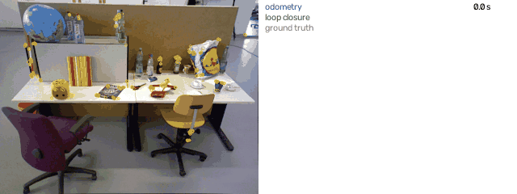
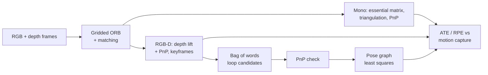
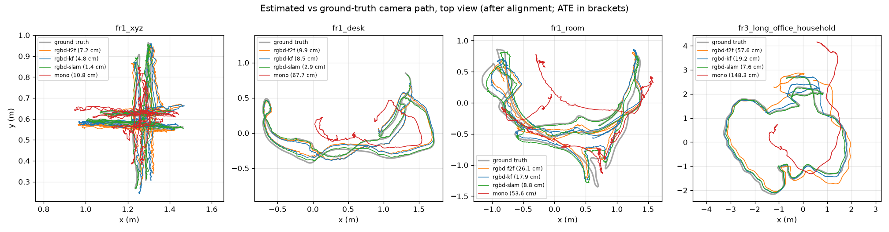
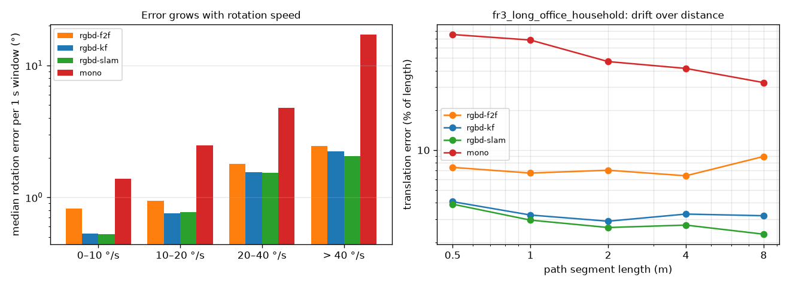

<div align="center">

# Visual Odometry and SLAM on TUM RGB-D

Estimating a hand-held camera's path from its images alone: feature-based monocular and RGB-D visual odometry, loop closure with pose-graph optimisation, and an analysis of where and why the estimate drifts, all scored against motion-capture ground truth.

[](https://github.com/haroonkhan02/visual-odometry-slam/actions/workflows/ci.yml)




</div>

## What it does

- Tracks a camera with ORB features. RGB-D mode lifts keypoints to 3-D with the depth image and solves PnP; monocular mode uses the essential matrix, triangulation and a keyframe map.
- Adds loop closure: a small bag of binary words finds places the camera has seen before, PnP verifies them, and a pose graph spreads the accumulated error around the loop.
- Scores every run with ATE and RPE as defined by the TUM benchmark, and checks every loop edge against ground truth to catch false matches.
- Breaks the error down by how fast the camera rotates and by distance travelled.



## Results

Four sequences of the [TUM RGB-D benchmark](https://cvg.cit.tum.de/data/datasets/rgbd-dataset). ATE is the RMSE of camera positions after alignment to motion capture (SE3 for RGB-D, Sim3 for monocular because its scale is unknown). Full table with frame-to-frame RGB-D, RPE and run statistics: [reports/vo_results.md](reports/vo_results.md).

| Sequence | Path (m) | RGB-D odometry ATE (cm) | + loop closure ATE (cm) | Loops | Mono ATE (cm) |
|---|---|---|---|---|---|
| fr1_xyz | 8.0 | 4.8 | 1.4 | 42 | 10.8 |
| fr1_desk | 9.3 | 8.5 | 2.9 | 4 | 67.7 |
| fr1_room | 16.0 | 17.9 | 8.8 | 29 | 53.6 |
| fr3_long_office_household | 22.1 | 19.2 | 7.6 | 26 | 148.3 |



Loop closure cut ATE by 51–70 % on every sequence. None of the 101 accepted loop edges was a false match: each one agrees with the ground-truth relative pose to within 5.2 cm and 3.2°. It fixes accumulated drift, not local error: RPE per second is almost unchanged. The whole RGB-D SLAM pipeline runs at 45–50 frames/s in one process on an Apple M5 CPU, including the loop search. Monocular odometry is usable only on the slow fr1_xyz; its parameters were tuned on that sequence alone, so the other three are untouched test data.

### Where the error comes from

From [reports/error_analysis.md](reports/error_analysis.md), all sequences pooled. Each 1 s window is binned by how far the camera really turned in it.

| Rotation in 1 s | Windows | RGB-D odometry error (cm, °) | Mono windows badly wrong |
|---|---|---|---|
| 0–10° | 1878 | 1.3, 0.53 | 53 % |
| 10–20° | 1632 | 1.6, 0.76 | 71 % |
| 20–40° | 1027 | 2.6, 1.55 | 77 % |
| > 40° | 407 | 4.7, 2.24 | 88 % |



Fast rotation is the main enemy. RGB-D error grows 3–4× from slow to fast windows (motion blur, and features leave the view before they can be matched), and monocular tracking collapses because pure rotation gives no parallax to triangulate new points. Over distance, odometry error keeps growing in absolute terms, but more slowly than the path length because errors partly cancel on back-and-forth motion. On fr3 the translation error stays at 2.3–3.9 % of segment length with loop closure, against 2.9–4.1 % without.

## Getting started

```bash
git clone https://github.com/haroonkhan02/visual-odometry-slam.git
cd visual-odometry-slam
uv venv --python 3.12 && source .venv/bin/activate
uv pip install -e ".[dev]"

vo-download              # four TUM sequences, ~3.1 GB of archives, resumable
vo-check                 # sequence statistics -> reports/dataset_stats.md
vo-run                   # all modes on every sequence (rgbd-f2f, rgbd-kf, rgbd-slam, mono)
vo-eval                  # ATE / RPE / loop accuracy -> reports/vo_results.md and figures
vo-analyse               # error vs rotation speed and distance -> reports/error_analysis.md
vo-demo                  # assets/demo.gif
pytest && ruff check .   # synthetic data only, no download needed
```

KITTI odometry is the usual driving benchmark, but its download needs a registration, so it is not fetched automatically. To use it, register at [cvlibs.net](https://www.cvlibs.net/datasets/kitti/eval_odometry.php), download the grayscale sequences and poses, and unpack them to `data/kitti/`.

## Repository structure

```text
visual-odometry-slam/
├── src/vo_slam/
│   ├── config.py         # paths, sequences, camera intrinsics
│   ├── download.py       # resumable TUM download and safe extraction
│   ├── tum.py            # TUM file formats, timestamp association, sequence loader
│   ├── geometry.py       # quaternions, SE(3) poses, rotation angles
│   ├── metrics.py        # Umeyama alignment, ATE, RPE
│   ├── features.py       # gridded ORB, undistortion, mutual ratio-test matching
│   ├── estimation.py     # PnP, essential matrix, triangulation (OpenCV)
│   ├── rgbd_vo.py        # depth-lifted keypoints + PnP, keyframe tracking
│   ├── mono_vo.py        # two-view init, PnP on a triangulated keyframe map
│   ├── slam.py           # bag of words, loop verification, pose-graph optimisation
│   ├── run.py            # vo-run: trajectories in TUM format
│   ├── evaluate.py       # vo-eval: ATE / RPE / loop accuracy tables and plots
│   ├── analysis.py       # vo-analyse: error by rotation speed and path length
│   ├── demo.py           # vo-demo: animated GIF
│   └── dataset_stats.py  # vo-check: sequence statistics and trajectory plot
├── tests/                # synthetic point clouds and rendered textured walls
├── reports/              # results, error analysis, figures, estimated trajectories
├── assets/               # demo GIF
└── data/                 # datasets (git-ignored)
```

## Design decisions

| Choice | Why |
|---|---|
| ORB on a 4×3 grid | Plain ORB can put every corner on one keyboard; spread-out points make PnP and the essential matrix well conditioned. |
| Keyframes instead of frame-to-frame | Every reference switch adds one pose error. On fr3 this is 260 switches instead of 2,488, and ATE drops from 57.6 to 19.2 cm. |
| Bag of words trained on the sequence's own keyframes | Small (256 words) and needs no external vocabulary. A real system would train it once on other data, as DBoW does. |
| PnP check plus consistency pruning | One false loop can bend the whole map. Loops must pass PnP with 60 inliers, and any loop that still disagrees after optimisation by more than 10 cm or 5° is dropped. None needed dropping here. |
| Batch pose graph in SciPy | Keyframe graphs have at most 351 nodes, so `least_squares` with a sparse Jacobian solves them in seconds. g2o or GTSAM would be the choice for online use. |
| Sim3 alignment only for monocular | One camera cannot observe scale; RGB-D is scored with a rigid alignment and has nowhere to hide scale errors. |

## Limitations and future work

- Loop closure runs once after tracking (offline). An online system would optimise whenever a loop is found, so tracking benefits immediately.
- The pose graph corrects keyframe poses only. Full bundle adjustment over points and poses, as in ORB-SLAM, would also reduce local error (ORB-SLAM2 reports roughly 1.5–5 cm ATE on the fr1 sequences).
- Monocular mode has no bundle adjustment and no loop closure, and loses tracking under fast rotation. Windowed BA is the next step there.
- Four indoor sequences only; no driving data (KITTI needs registration) and no dynamic scenes.

## License

[MIT](LICENSE) © Muhammad Haroon Khan. TUM RGB-D data © TU Munich, CC BY 4.0.
