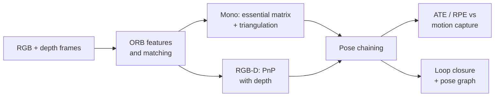

<div align="center">

# Visual Odometry and SLAM on TUM RGB-D

Estimating a hand-held camera's path from its images alone: feature-based monocular and RGB-D visual odometry, measured drift, and loop closure with pose-graph optimisation, scored against motion-capture ground truth.

[](https://github.com/haroonkhan02/visual-odometry-slam/actions/workflows/ci.yml)


</div>

Work in progress. The data pipeline, the TUM file formats, frame association and the trajectory metrics (ATE with Umeyama alignment, RPE) are in place and tested. The odometry front end comes next, then results, drift analysis and loop closure.

## Planned approach

- Data: four sequences of the [TUM RGB-D benchmark](https://cvg.cit.tum.de/data/datasets/rgbd-dataset) (CC BY 4.0, 640x480 at 30 Hz, motion-capture ground truth at 100 Hz): `fr1_xyz`, `fr1_desk`, `fr1_room` and `fr3_long_office_household`. `fr3_long_office_household` circles two desks and ends 0.75 m from its start, and `fr1_room` crosses its own path several times; revisits like these are what loop closure needs ([statistics](reports/dataset_stats.md)).
- Monocular VO: ORB features, essential matrix with RANSAC, pose recovery and triangulation. Scale is unobservable from one camera, so it is evaluated after a similarity (Sim3) alignment.
- RGB-D VO: the same features lifted to 3-D with the depth image, then PnP with RANSAC, which gives metric scale directly.
- Metrics: absolute trajectory error (ATE RMSE) and relative pose error (RPE per second), as defined by the TUM benchmark.
- Stretch: loop detection and pose-graph optimisation, to show how much drift a single loop removes.



## Getting started

```bash
git clone https://github.com/haroonkhan02/visual-odometry-slam.git
cd visual-odometry-slam
uv venv --python 3.12 && source .venv/bin/activate
uv pip install -e ".[dev]"

vo-download              # four TUM sequences, ~3.1 GB of archives, resumable
vo-check                 # sequence statistics -> reports/dataset_stats.md
pytest && ruff check .   # synthetic data only, no download needed
```

KITTI odometry is the usual driving benchmark, but its download needs a registration, so it is not fetched automatically. To use it, register at [cvlibs.net](https://www.cvlibs.net/datasets/kitti/eval_odometry.php), download the grayscale sequences and poses, and unpack them to `data/kitti/`.

## Repository structure

```text
visual-odometry-slam/
├── src/vo_slam/
│   ├── config.py         # paths, sequences, camera intrinsics
│   ├── download.py       # resumable TUM download and safe extraction
│   ├── tum.py            # TUM file formats, timestamp association, sequence loader
│   ├── geometry.py       # quaternions, SE(3) poses, rotation angles
│   ├── metrics.py        # Umeyama alignment, ATE, RPE
│   └── dataset_stats.py  # vo-check: sequence statistics and trajectory plot
├── tests/                # synthetic sequences and trajectories
├── reports/              # generated statistics and figures
└── data/                 # datasets (git-ignored)
```

## License

[MIT](LICENSE) © Muhammad Haroon Khan. TUM RGB-D data © TU Munich, CC BY 4.0.
