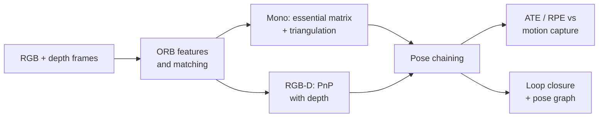

<div align="center">

# Visual Odometry and SLAM on TUM RGB-D

Estimating a hand-held camera's path from its images alone: feature-based monocular and RGB-D visual odometry, measured drift, and loop closure with pose-graph optimisation, scored against motion-capture ground truth.

[](https://github.com/haroonkhan02/visual-odometry-slam/actions/workflows/ci.yml)


</div>

Work in progress. RGB-D and monocular odometry run on all four sequences and are scored below. Monocular tracking still loses the camera on fast motion and has no bundle adjustment yet. Next: error analysis, loop closure with pose-graph optimisation, and a demo.

## First results

ATE is the RMSE of camera positions after alignment to motion capture (SE3 for RGB-D, Sim3 for monocular because its scale is unknown). RPE is over 1 s windows. Full table with frame-to-frame RGB-D and run statistics: [reports/vo_results.md](reports/vo_results.md).

| Sequence | Path (m) | RGB-D ATE (cm) | RGB-D RPE (cm/s, °/s) | Mono ATE (cm) | Mono lost |
|---|---|---|---|---|---|
| fr1_xyz | 8.0 | 4.8 | 2.2, 1.32 | 10.8 | 2 |
| fr1_desk | 9.3 | 8.5 | 3.2, 2.07 | 67.7 | 6 |
| fr1_room | 16.0 | 17.9 | 5.2, 2.26 | 53.6 | 31 |
| fr3_long_office_household | 22.1 | 19.2 | 1.7, 0.80 | 148.3 | 2 |


RGB-D odometry with keyframes never lost tracking and runs at about 56 frames/s in one process on an Apple M5 CPU. Tracking against a keyframe instead of the previous frame lowered ATE on every sequence (fr3: 57.6 → 19.2 cm), because fewer small errors are chained together. Local error stays small (0.8–2.3 °/s), but it adds up over a long loop, which is what loop closure should fix. Monocular odometry is usable on the slow fr1_xyz only. On fr1_desk and fr1_room fast rotation breaks tracking, and every re-initialisation guesses a new scale. Its parameters were tuned on fr1_xyz alone, so the other three sequences are untouched test data.

## Planned approach

- Data: four sequences of the [TUM RGB-D benchmark](https://cvg.cit.tum.de/data/datasets/rgbd-dataset) (CC BY 4.0, 640x480 at 30 Hz, motion-capture ground truth at 100 Hz): `fr1_xyz`, `fr1_desk`, `fr1_room` and `fr3_long_office_household`. `fr3_long_office_household` circles two desks and ends 0.75 m from its start, and `fr1_room` crosses its own path several times; revisits like these are what loop closure needs ([statistics](reports/dataset_stats.md)).
- Monocular VO: ORB features, essential matrix with RANSAC, pose recovery and triangulation. Scale is unobservable from one camera, so it is evaluated after a similarity (Sim3) alignment.
- RGB-D VO: the same features lifted to 3-D with the depth image, then PnP with RANSAC, which gives metric scale directly.
- Metrics: absolute trajectory error (ATE RMSE) and relative pose error (RPE per second), as defined by the TUM benchmark.
- Stretch: loop detection and pose-graph optimisation, to show how much drift a single loop removes.



## Getting started

```bash
git clone https://github.com/haroonkhan02/visual-odometry-slam.git
cd visual-odometry-slam
uv venv --python 3.12 && source .venv/bin/activate
uv pip install -e ".[dev]"

vo-download              # four TUM sequences, ~3.1 GB of archives, resumable
vo-check                 # sequence statistics -> reports/dataset_stats.md
vo-run                   # RGB-D (frame-to-frame, keyframe) and mono on every sequence, ~5 min
vo-eval                  # ATE / RPE -> reports/vo_results.md and figures
pytest && ruff check .   # synthetic data only, no download needed
```

KITTI odometry is the usual driving benchmark, but its download needs a registration, so it is not fetched automatically. To use it, register at [cvlibs.net](https://www.cvlibs.net/datasets/kitti/eval_odometry.php), download the grayscale sequences and poses, and unpack them to `data/kitti/`.

## Repository structure

```text
visual-odometry-slam/
├── src/vo_slam/
│   ├── config.py         # paths, sequences, camera intrinsics
│   ├── download.py       # resumable TUM download and safe extraction
│   ├── tum.py            # TUM file formats, timestamp association, sequence loader
│   ├── geometry.py       # quaternions, SE(3) poses, rotation angles
│   ├── metrics.py        # Umeyama alignment, ATE, RPE
│   ├── features.py       # gridded ORB, undistortion, mutual ratio-test matching
│   ├── estimation.py     # PnP, essential matrix, triangulation (OpenCV)
│   ├── rgbd_vo.py        # depth-lifted keypoints + PnP, keyframe tracking
│   ├── mono_vo.py        # two-view init, PnP on a triangulated keyframe map
│   ├── run.py            # vo-run: trajectories in TUM format
│   ├── evaluate.py       # vo-eval: ATE / RPE tables and plots
│   └── dataset_stats.py  # vo-check: sequence statistics and trajectory plot
├── tests/                # synthetic point clouds and rendered textured walls
├── reports/              # results, figures, estimated trajectories
└── data/                 # datasets (git-ignored)
```

## License

[MIT](LICENSE) © Muhammad Haroon Khan. TUM RGB-D data © TU Munich, CC BY 4.0.
